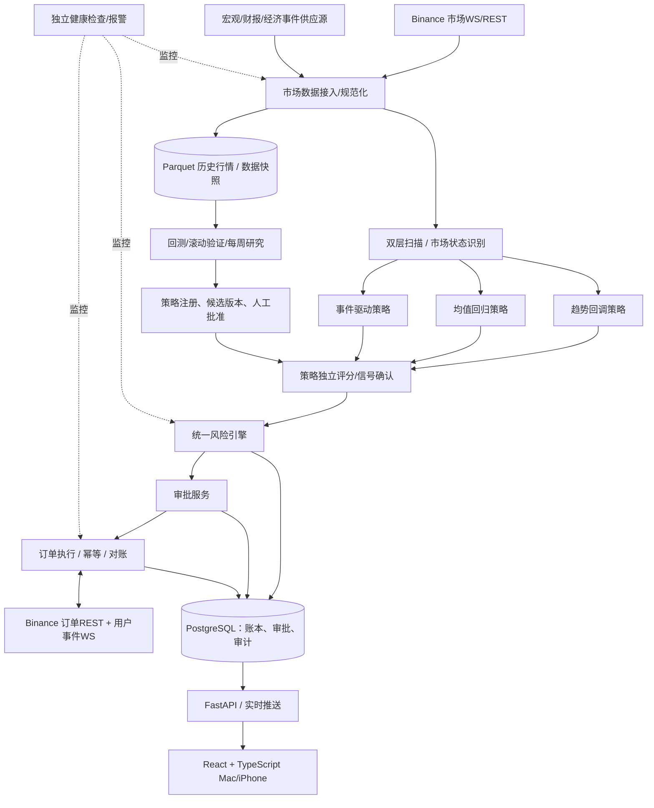

# Quant System V1.0 — 正式技术蓝图与需求规格说明书

**版本**：1.0 (Blueprint)  
**需求冻结日期**：2026-10-10  
**项目状态**：设计已完成；尚未开发、接入账号、验证资金权限或完成实盘验证  
**目标**：Binance 生态中与美股价格、能源、贵金属相关的可用永续合约，三策略研究、信号、模拟交易与人工批准执行。

> **关键边界**：Binance TradFi USDT永续衍生品 ≠ 美股股票所有权 ≠ CME传统期货。市场准入、产品交易资格、API可用性以及实际合约规格，须以账户和交易所当期接口核验为准。禁止假设符号一经公告就一定对所有用户开放。系统不保证盈利，风险阈值不保证亏损一定被限制在该数值内。

## 0. 需求决议目录（42轮，不随意修改）

| 轮次 | 确认决定 |
|---|---|
| 01 | B+C：量化信号 + 半自动交易 |
| 02 | C+E：美股与期货市场（在Binance交易时以匹配的可用衍生品落地） |
| 03 | A+B+F：趋势跟踪、均值回归、事件驱动；D宏观分析为辅助 |
| 04 | 前期B+C：日内、1–5日波段；大后期D+E：1–4周与1–6个月 |
| 05 | A+D+E：美股相关、能源、贵金属 |
| 06 | B+C+D：趋势回调、超买超卖、事件触发；不采用独立的追突破作为主入场模式 |
| 07 | A+B+F+G：价格行为、趋势指标、统计模型、跨市场数据 |
| 08 | D：策略独立运行 + 市场状态自适应优先级 |
| 09 | B+C：单笔风险预算0.5%–1% |
| 10 | B+C：单日1.5%预警、2%熔断 |
| 11 | C：账户最高权益回撤10%熔断 |
| 12 | C：同时持仓计划风险总额5%上限 |
| 13 | C：无额外跨品种相关性硬限制（仅监测提示） |
| 14 | B+C+D+E+F：1m、5m、15m、1h、1d，不要求Tick作为基础主数据 |
| 15 | C：核心自选池 + 全市场机会扫描双层机制 |
| 16 | A+C+E+F：成交量异常、趋势回调、事件催化、跨市场联动用于扫描 |
| 17 | C：三策略独立评分、独立排行 |
| 18 | C：可解释初始固定权重 + 回测验证/优化 |
| 19 | C：候选识别 → 条件确认，两阶段信号 |
| 20 | D：技术结构止损 + ATR等波动率校正 |
| 21 | 前期D：分批止盈+移动止损；后期E：各策略独立退出规则 |
| 22 | C：动态时间止损，按交易假设是否失效判断 |
| 23 | D：异常行情/技术故障分级应急保护 |
| 24 | D：真实成本回测、滚动样本外、模拟盘、版本比较的完整验证链 |
| 25 | A：净收益、胜率、盈亏比、期望收益、盈利因子为准入评估优先项；仍受强制风控与第24轮验证约束 |
| 26 | C：自动研究 + 人工批准策略版本发布 |
| 27 | B：每周定期研究与参数优化，不强制每周更新版本 |
| 28 | C：接入用户指定平台 |
| 29 | Binance |
| 30 | C：Mac本地研究 + 云服务器实时运行 |
| 31 | D：Mac + iPhone统一多终端界面 |
| 32 | D：普通、重要交易、紧急风险三级智能通知 |
| 33 | D：模块化综合控制台，首页使用极简决策驾驶舱 |
| 34 | D：专业K线、策略叠加、多周期联动、历史回放 |
| 35 | C：分层混合存储 |
| 36 | A：Python + TypeScript |
| 37 | C：WebSocket事件驱动 + 定时数据核对混合计算 |
| 38 | C：故障进入安全模式、同步核对、自检与人工恢复 |
| 39 | C：双因素认证、权限隔离、审批记录、安全审计及紧急锁定 |
| 40 | C：业务与基础设施全链路监测报警 |
| 41 | C：分阶段建设与准入 |
| 42 | D：工程、策略、模拟、风控、安全综合验收 |

**已定的交易偏好与落地提醒**：多空双向交易；不自动开仓；资金风控优先；高评分不等于高胜率；成交量异常不能直接解释为主动资金流入；D阶段长周期是扩展，不应阻塞V1。

## 1. 产品边界与系统职责

### 1.1 典型使用链路
1. 从Binance合约信息与授权数据源发现可分析的品种；校验可交易状态与交易规则。
2. WebSocket接收实时行情，定时任务补缺/校验；聚合1m、5m、15m、1h、1d。
3. 扫描核心自选池及合资格自动扫描池，产生策略候选机会。
4. 市场状态识别引擎决定策略的相对优先级，不强制消除信号冲突。
5. 趋势回调、均值回归、事件驱动三套策略分别生成0–100分的可解释评分。
6. 对候选机会进行第二阶段触发确认；若失效/过期则关闭候选。
7. 计算入场、结构+波动率止损、初始计划风险、仓位、交易费率、资金费率与保证金。
8. 统一风控审核；通过后生成不可变交易审批快照。
9. 在Mac/iPhone身份验证后，用户确认具体订单；交易执行引擎凭有效签名/令牌提交。
10. 用户数据流+REST核对成交、持仓、费用、止损单与风险敞口，持续管理退出。
11. 独立记账、复盘、绩效验证；每周自动研究候选版本，只有人工批准才能部署。

### 1.2 不做的事
- 不做毫秒级/亚毫秒级高频与做市。
- 不做无人监督的开仓、自动发布策略或自行解除熔断。
- 不假设所有价格指数、新闻、EIA/FOMC事件有免费、可靠、历史准确的数据接口。
- 不将模拟成交等同真实成交，不在回测中忽视资金费率、滑点或清算风险。
- V1不要求分布式集群与主备热切换。

## 2. 高层架构（可用模块化单体 + 独立Worker）



推荐采用 **一个仓库、清晰模块边界、多个进程** 的模块化单体：`api`、`market_worker`、`signal_worker`、`execution_worker`、`research_worker`、`monitor_worker`，不在V1引入复杂微服务。Redis用于短期缓存和通知分发，不是持仓、审批及订单真实状态的唯一来源；重要事件通过PostgreSQL事务性outbox和持久化重放记录保护。

### 2.1 进程边界
- `market_worker`：市场连接、心跳、行情规范化、bar闭合、水位线、缺口修复、合约规格更新。
- `signal_worker`：扫描、趋势/回归/事件引擎、市场状态识别、分策略评分、信号状态机。
- `risk_service`：统一纯函数风控计算 + 受保护的全局kill switch；交易前后复核。
- `execution_worker`：只接收审批过的订单快照；提交、查询、撤单、部分成交、恢复与对账。
- `research_worker`：回测、walk-forward、报告、候选版本、每周定期优化。
- `api`：会话与2FA、订单审批、读模型、图表、通知、日志。
- `monitor_worker`：监控平台资源、业务心跳、延迟、异常、外部告警。

## 3. 交易标的与交易所适配（必须先做可行性闸门）

### 3.1 两个不同概念：研究标的 vs 可交易合约
- `underlying_asset`：NVDA股票、WTI原油、黄金等真实底层经济对象。
- `instrument`：Binance `NVDAUSDT`、`CLUSDT`、`XAUUSDT` 等合约，包含venue、合约类别、计价/结算币种、合约乘数、tick/step、交易状态、价格来源与结算规则。
- 需要专门建立映射 `underlying_id <-> instrument_id`，永不混用两者历史行情。
- 不同TradFi商品与股权合约在底层交易时段、指数更新时间与非交易时段价格形成机制可能不同；相关字段需要版本化记录。

### 3.2 第0阶段只读技术核验清单
1. 查询合约清单、`TRADING`状态、tick size、step size、min notional及受支持订单类型。
2. 验证该账户所在地及交易权限允许使用哪些合约；个人账户手动确认适用条款，不自动调用签署协议接口。
3. 验证历史K线、实时市场WS、资金费率、标记价格、指数价格数据对该品种是否实际返回。
4. 验证测试环境是否提供目标TradFi符号和所需条件订单；如不提供，使用自建完全隔离的paper broker模拟适配器。
5. 仅在授权且经过阶段四的情况下，验证受控订单接口、查询与撤单；禁止为了验证而在真实账户盲目开仓。
6. 标记无法获取的数据为`UNAVAILABLE`，不得以零值或猜测填充。

### 3.3 官方文档基线（需开发时复核版本）
- Binance官方公告：https://www.binance.com/en/support/announcement/detail/ecf7318c0d434c339e80878588e700d0
- 商品TradFi 2026-09-16更新：https://www.binance.com/zh-CN/support/announcement/detail/f69c05ebdba7422e9c614685abe84dc5
- USDⓈ-M行情API：https://developers.binance.com/en/docs/catalog/core-trading-derivatives-trading-usd-s-m-futures/api/rest-api/market-data
- USDⓈ-M交易API：https://developers.binance.com/en/docs/catalog/core-trading-derivatives-trading-usd-s-m-futures/api/rest-api/trade
- 市场可交易合约查询：`GET /fapi/v1/exchangeInfo`；交易时段资料：`GET /fapi/v1/tradingSchedule`；实际订单接口按官方当前规格验证。
- 注意：官方有另一个“Stocks Trading API”产品，不能与USDT股权永续合约混为一谈。

## 4. 市场数据、交易时钟与质量控制

**时间标准**：数据库与计算全部使用UTC带时区时间戳，界面转为Asia/Shanghai；另存`exchange_event_at`、`received_at`、`processed_at`，事件数据保存`published_at`及真正可用的`available_at`。市场本地时区与DST按官方日历处理。

**行情**：1m基础K线，聚合5m/15m/1h/1d时仅使用已闭合的源bar；记录`is_closed`、`source`、`quality_status`、交易时段模式；REST回填历史与缺口。不保证币安所有TradFi品种的K线频率/深度一样。

**市场扫描双层**：
- `watchlist`：指定监控清单，实时更新；
- `discovery`：从授权可交易合约库中选择满足最低成交活跃度、数据完整性条件的合约；核心条件为成交量异动、趋势回调、事件催化、跨市场异常；
- 扫描器不把“筛选命中”当成可交易信号。

**跨市场数据**：美元指数、美债收益率、相关标的与宏观发布日历通常需要单独授权和供应商。标识`provider`、`license`、`availability_lag`、`asof`；不可用时降级评分可信度、屏蔽依赖该数据的策略，不伪造宏观中性信号。

**质量闸门**：延迟超阈值、gap无法修复、ohlc逻辑不合法、价格异常、交易时段不符、标记/指数异常脱节 -> 禁止受影响标的新增开仓；可保留只减仓/人工处理。阈值需研究与测试后配置。

## 5. 策略与信号

### 5.1 独立策略接口
统一输入为 `MarketContext`（时间、bar、多市场特征、事件、市场状态、数据质量、instrument规则），输出`CandidateSignal`（策略ID/版本、方向、候选价格区间、理由、特征快照、score、confidence_notes、失效条件）。

| 策略 | 识别逻辑 | 触发确认 | 特别限制 |
|---|---|---|---|
| TrendPullback | 1d/1h方向、结构高低点、回调幅度、均线位置 | 指定级别bar收盘后反转或回归趋势结构条件 | 不把向上突破作为唯一主要入场逻辑 |
| MeanReversion | Z-score/偏离分布、均值回归窗口、价格结构 | 反向价格行为/统计回归启动迹象 | 强趋势/新闻冲击期间允许拒绝交易 |
| EventDriven | 财报、宏观数据、原油库存、政策或重大新闻 | 事件发布后，用真实可用时间之后的价格反应确认 | 必须存储事件来源、发布时间、修订状态 |

**市场状态识别**：趋势、震荡、事件冲击、不确定四态；用于调整优先级而非简单三策略投票。允许冲突并列展示或不交易。

**策略独立评分**：各自0–100分，先设可解释权重，回测/样本外验证后校准。跨策略评分不可直接等同概率，核心阈值暂未决定，先保留配置项。信号输出既包括多空方向、结构与统计依据，也包括风险、资金费率、流动性及数据质量。

### 5.2 两阶段信号状态机
`DISCOVERED -> WATCHING -> CONFIRMED -> RISK_APPROVED -> PENDING_HUMAN -> APPROVED -> SUBMITTED -> FILLED/PARTIAL/REJECTED/CANCELLED/EXPIRED`

分支状态包括`INVALIDATED`（结构改变/数据异常）、`CONFLICTED`（策略冲突）、`BLOCKED_BY_RISK`。审批快照包含所有关键报价、手数、止损、价格容忍区间、有效期、策略版本、风控结果的hash；只要订单关键参数改变则审批自动失效。

### 5.3 退出逻辑
- V1：分批止盈 + 移动止损；触发目标R倍数与分仓比例均为**回测参数**，不强制定死“2R/50%”。
- 混合初始止损：交易假设失效价位 + 波动率缓冲；不可为扩大仓位随意收紧止损。
- 动态时间止损：价格推进效率、市场状态、原始逻辑失效；不是固定X小时平仓。
- 按品种规则管理隔夜、价格模式转换、资金费率结算与清算风险。
- V2再引入策略独立退出模型，不应让V1无序膨胀。

## 6. 风险控制（冻结阈值与可计算定义）

| 控件 | 已确认阈值 | 动作 |
|---|---:|---|
| 常规单笔风险 | 0.5%权益 | 允许参与，经交易前审核 |
| 高质量信号单笔风险 | 最多1%权益 | 须经实证阈值证明；评分高不自动给1% |
| 当日一级线 | -1.5% | 发出预警，暂停常规新开仓 |
| 当日二级线 | -2% | 冻结全部增加风险的新订单 |
| 账户最高权益回撤 | -10% | 账户级熔断，人工复核后才能解锁 |
| 同时计划风险 | 5%权益 | 总计划风险超标拒绝新开仓 |
| 同组相关性 | 无附加硬限制 | 仅显示提示；保留整体5%硬上限 |

**风险计算标准**：
- `equity`：同一计价基准（首选USDT）的净值，包含浮盈亏、保证金/负债、费用与必要折算；记录折算价格及时间，极端情况下USDT脱锚风险额外提示。
- `daily_baseline`：本账户“风控日”开始时净权益快照；風控日定义在实施前确认，不能简单把现货24/7与美国股市日界线混淆。
- `day_pnl_pct = (current_equity - daily_baseline_adjusted_for_flows) / daily_baseline_adjusted_for_flows`；转入转出资金需要剔除影响。
- `high_water_mark`：经资金流调整的历史权益高水位，`drawdown=(equity-HWM)/HWM`。
- `planned_trade_risk`：理论止损价损失 + 预计手续费/滑点（必要时另保留压力缓冲）。合约按合约乘数、结算币种、实际tick与step计算；不得把名义本金当损失。
- `portfolio_open_risk`：未平仓头寸的止损情境增量损失 + 待成交开仓订单预留风险；对已出现的浮盈、止损位置应作一致口径处理，不能因保证止损就假设极端行情无跳空风险。
- `size = floor_to_step(allowed_risk / estimated_per_unit_stop_loss)`，并再次检查最小数量、最小名义金额、保证金、预估清算价、流动性和可用余额；任何项不满足则拒绝。

**优先级**：账户熔断 > 当日亏损熔断 > 市场/系统安全模式 > 总风险 > 单笔风险 > 策略偏好。任何风险锁定状态允许在系统可用且交易所支持时执行明确的reduce-only风险降低操作，禁止“锁住后无法减仓”。未实现及已实现亏损均计入当日线。

**特别说明**：总计划风险5%与当日熔断2%可能在极端行情冲突。2%触发即禁止新增风险，不能保证已有风险立即归零或总日损失不超2%。需要压力情景校验和前端醒目说明。

## 7. 交易订单、审批与故障安全

### 7.1 订单流程
1. 后端生成带`approval_id`、过期时间和参数摘要的订单计划。
2. 用户在通过2FA的Web控制台查看确认，不在消息通知中放置未经二次授权的一键实盘下单URL。
3. 服务器验证用户会话、审批完整性、策略版本、行情有效期、账户风险状态和当前交易所合约规则。
4. 采用事务性发单记录 + 有效的`client_order_id`，仅一个execution worker持有实际提交权限。
5. 接收订单ACK、成交事件与REST订单核对；记录部分成交、拒单、撤单、保护单状态。
6. 如果出现网络超时或状态未知：**先按clientOrderId及订单列表查询并对账，不能盲目重新提交新订单**。
7. 任何变更交易方向/价格/止损/数量须重新审批，过期审批不可执行。

### 7.2 应急与恢复
状态：`NORMAL`、`DEGRADED`、`NO_NEW_RISK`、`HALTED_PENDING_RECONCILIATION`、`MANUAL_REENABLE_REQUIRED`。
- Level 1：数据或市场异常告警；
- Level 2：受影响标的或全系统禁止新增风险；
- Level 3：交易状态无法确认、API故障、账户数据失效等，进入安全模式；
- 恢复：重连 -> REST订单/成交/持仓/余额核对 -> 缺口回放 -> 风控重算 -> 自检 -> 人工再开启。关键锁定状态持久化到数据库，不能因重启自动消失。
- 交易所保护性订单优先采用经过实际接口验证的订单类型；需要对单向/双向持仓模式、`reduceOnly`及条件单触发配置逐一验证，不做泛化假设。

## 8. 技术栈与部署

- **后端/研究**：Python 3.12+（目标版本在初始化时锁定），FastAPI、Pydantic、SQLAlchemy/Alembic、NumPy、Pandas、DuckDB、PyArrow；统计与优化工具按需选择且锁定版本。
- **前端**：TypeScript、React、Vite（或成熟同级框架，初版选型冻结后不频繁更换）、移动响应式组件；图表优先采用成熟且符合授权条款的K线方案。
- **永久数据**：PostgreSQL订单/审批/审计/策略元数据；Parquet历史行情和研究快照；对象存储备份。
- **研究缓存**：Mac本地DuckDB/Parquet只读或版本化研究副本。
- **临时缓存**：Redis用于实时读取缓存与非关键推送；重要事件保存到数据库outbox。
- **部署**：Mac用于编程/回测；云服务器负责API、实时Worker、账户同步和报警。容器使用Docker Compose进行第一阶段可重复部署；在生产前加入自动备份、恢复演练、最小权限和网络限制。
- **安全**：服务端保存最小权限交易密钥；独立服务账户与DB权限；禁止提币权限；IP白名单；2FA、会话过期、审批hash、操作审计、紧急锁定；密钥不入源码、不入日志、不入Git。

## 9. 数据库逻辑设计

| 表 / 数据集 | 主键/关键字段 | 说明 |
|---|---|---|
| `instruments` | `id,venue,symbol,underlying_id,kind,status,spec_version` | 可交易合约及交易规则，规格变动保留版本 |
| `underlyings` | `id,asset_class,underlying_symbol` | 真实经济标的 |
| `market_bars`（Parquet） | `instrument_id,timeframe,open_time,closed_at,OHLCV,source` | 历史K线及数据质量 |
| `market_snapshots` | `id,instrument_id,asof,mark,index,spread,funding` | 交易决策快照 |
| `external_events` | `id,event_type,published_at,available_at,revision,provider,payload_hash` | 宏观/新闻/公司事件point-in-time数据 |
| `strategy_versions` | `id,strategy_id,version,code_hash,params_hash,approved_at,state` | 不可覆盖策略版本 |
| `research_runs` | `id,dataset_hash,split_info,metrics,code_hash,created_at` | 回测与研究运行元数据 |
| `signals` | `id,strategy_version,instrument_id,side,score,stage,expires_at,feature_snapshot` | 两阶段信号及可解释理由 |
| `risk_snapshots` | `id,equity,daily_pnl,drawdown,portfolio_risk,lock_state,asof` | 风险快照 |
| `approval_requests` | `id,signal_id,order_hash,nonce,expires_at,status,approved_by` | 不可变审批 |
| `orders` | `id,approval_id,client_order_id,exchange_order_id,status,order_spec` | 幂等订单主记录 |
| `order_events` | `id,order_id,event_type,exchange_at,received_at,raw_hash` | 订单状态流水，不可随意覆盖 |
| `fills` | `id,order_id,fill_id,qty,price,fee,fee_asset,executed_at` | 实际成交去重 |
| `positions` | `account_id,instrument_id,position_side,quantity,entry,...` | 由真实成交与账户对账形成 |
| `equity_ledger` | `id,account_id,event_type,amount,asset,asof` | 费用、资金费率、余额变动、转入转出 |
| `system_incidents` | `id,severity,started_at,resolved_at,reason,actions` | 全链路运行故障 |
| `audit_logs` | `id,actor,action,target,before_hash,after_hash,at` | 不可篡改方向设计，受控保留 |
| `outbox_events` | `id,event_type,payload,status,next_attempt` | 事务性消息发布与重试 |

对价格、金额、合约数量使用数据库`NUMERIC`/Python`Decimal`，交易路径避免二进制浮点舍入问题；主时钟采用UTC，外部事件历史保存原始数据和修订版本；数据不可用时显式标记，不做零值填充。

## 10. 内部API规范（初版建议）

统一前缀 `/api/v1`，鉴权必需，所有修改接口幂等或有并发控制；HTTP返回错误码含可诊断业务错误，无敏感凭证。

### 读接口
- `GET /health/live`：进程存活（不代表可交易）。
- `GET /health/ready`：连接、数据时效、对账和风控准备状态。
- `GET /instruments`：可交易合约/可用性/规格。
- `GET /market/bars?instrument_id=&timeframe=&from=&to=`：历史K线。
- `GET /market/status`：数据质量和市场时段。
- `GET /signals?state=&strategy=&instrument_id=`：信号列表。
- `GET /signals/{id}`：评分理由、快照、交易计划、有效期。
- `GET /portfolio`：账户权益、持仓和风险。
- `GET /risk/status`：风控状态、阈值和历史触发。
- `GET /orders/{id}`：订单提交与成交状态。
- `GET /research/runs`、`GET /research/runs/{id}`：回测与验证报告。
- `GET /strategies`、`GET /strategies/{id}/versions`：策略与版本。
- `GET /incidents`：故障、事件及处理。

### 变更接口（初始全部模拟）
- `POST /signals/{id}/prepare-order`：使用当前快照构造预订单，执行交易前风控。
- `POST /approvals`：生成审批请求与快照hash。
- `POST /approvals/{id}/approve`：二次认证后批准（仅批准当前不可变快照）。
- `POST /approvals/{id}/reject`：拒绝交易。
- `POST /orders/{id}/cancel`：申请撤单，异步状态可查询。
- `POST /risk/kill-switch`：锁定新增风险，记录审计。
- `POST /risk/recover-request`：触发自检与人工恢复审批流程。
- `POST /research/runs`：启动异步研究，返回job_id。
- `POST /strategy-versions/{id}/approve`：审批发布新策略版本。

实时控制台采用`WS /api/v1/stream`（仅对认证用户）推送市场/信号/账户/风控更新。所有POST显式使用`Idempotency-Key`或领域唯一标识；错误恢复时通过GET查询真实状态，不重发模糊订单。

### 典型Signal输出（字段示例，非行情）
```json
{
  "signal_id": "sig_01",
  "instrument_id": "binance_um_xauusdt",
  "strategy": "trend_pullback",
  "strategy_version": "1.0.0",
  "market_regime": "TREND",
  "direction": "LONG",
  "stage": "CONFIRMED",
  "score": 87,
  "score_is_probability": false,
  "generated_at": "2026-10-10T00:00:00Z",
  "expires_at": "2026-10-10T00:05:00Z",
  "rationale": ["趋势方向满足条件", "回调结构确认"],
  "market_data_quality": "VALID",
  "trade_plan_status": "REQUIRES_RISK_CHECK"
}
```

## 11. 前后端界面信息架构

**首页/决策驾驶舱**：权益、日盈亏、历史最高点回撤、总计划风险、风控锁状态、待审批信号、高优先级异常。

**交易台**：行情K线、1m/5m/15m/1h/1d、指标、策略标注、订单book/明细/持仓、费用与资金费率、交易记录。

**研究中心**：策略报告、独立评分分布、回测曲线、walk-forward、成本敏感性、历史回放、版本对比与人工审批。

**风控中心**：单笔与总风险、2%当日风控线、10%回撤、高水位、模拟压力损失、锁定状态、紧急停止。

**系统/数据中心**：合约规则、数据延迟、服务健康、行情缺口、任务/日志、密钥状态（永不展示密钥明文）、备份状态。

**通知**：普通机会简讯；高质量机会附交易计划与风险摘要；紧急异常高优先级提示。通知不是风控的唯一通道，不支持未授权一键实盘下单。

## 12. 回测、优化与验收

### 12.1 回测真实性
- 逐时点可用数据（as-of join）；严格记录事件原始发布时间及修订信息。
- 价差、滑点、Maker/Taker费、资金费率、最小下单量、lot/tick、合约清算/强平风险及订单成交约束。
- 非底层交易时段采用该合约当期的交易规则与价格形成模型；不得以股票常规时间价格当作全天合约价格。
- 历史回放中只有当时已形成/已接收的bar可用，禁止look-ahead；数据质量差时结果标记不可信。
- 考虑品种新上市、退市、历史不完整造成的生存偏差；不足历史的策略不可冒充长期验证。

### 12.2 样本外与每周研究
- 研究数据按时间段划分训练/验证/独立测试，滚动forward（walk-forward），同一测试集不能被反复用于调参而失去独立性。
- 必须记录手续费/资金费率压力敏感性及蒙特卡洛交易顺序扰动（视样本而定），并与基准对照。
- **每周**运行研究与候选优化；新版本必须拥有独立报告、参数冻结及人工审批。收益指标优先，但不能越过硬风险或稳定性验证。
- 高质量交易风险1%的资格要求在独立数据集上有证据，具体样本量/门槛当前未决。

### 12.3 六阶段开发与完成定义

| 阶段 | 实施内容 | 退出准则 |
|---|---|---|
| 0 交易可行性 | Binance市场/合约/API权限及数据授权清单 | 明确可接入品种与不可用功能，基于只读验证 |
| 1 数据+研究 | 项目骨架、数据管道、三策略、回测、报告 | 可复现同一数据的回测，测试通过 |
| 2 实时信号 | WebSocket、数据完整性、双层扫描、评分/确认、通知 | 历史回放与实时同样输入生成一致状态结果；数据断流安全降级 |
| 3 模拟盘 | Paper broker、订单状态机、组合风控、审批 | 模拟异常场景、部分成交、撤单与锁定均通过 |
| 4 实盘准备 | 授权真实交易适配层、密钥、2FA、对账、应急、自检 | 只读/模拟生产环境演练与安全测试完成，人工批准开通 |
| 5 小额实盘 | 明确交易资格后受控小额、订单/费用真实性验证 | 交易无重复、风控操作一致、实盘成本可度量；不设虚构收益承诺 |
| 6 完整平台 | 多终端完整UI、回放、自动研究、全链路监控 | 全部需求功能测试及灾难恢复演练通过 |

### 12.4 必须通过的测试用例（作为Codex工作清单）
1. 同一条WebSocket消息重复三次 -> 只产生一个bar/候选。
2. 5分钟K线未收盘 -> 不触发配置为收盘确认的信号。
3. 网络超时但交易所订单已经成交 -> 能查回原单，不重新下单。
4. 用户在Mac和iPhone同时批准同一交易 -> 只产生一次订单。
5. 开仓后市场价格跳空 -> 风险指标显示真实超出预算的损失，不伪装止损必成。
6. 当日亏损>=1.5% -> 停止常规新增风险；>=2% -> 全部新增风险被拒。
7. 组合计划风险在4.7%，新订单风险0.5% -> 拒单。
8. 权益从高水位回撤>=10% -> 触发持久锁定，重启不能清除。
9. 风控引擎不可用/行情过期 -> 新开仓拒绝；经过授权的减仓处理不被无条件封堵。
10. 事件数据实际在14:32公布、事件日期写成14:30 -> 回测14:30不得提前读取内容。
11. 恢复网络 -> 订单、成交、资金费率、持仓、余额逐项核对完成后才允许人工重启。
12. 策略每周优化但未获批准 -> 线上版本保持完全不变。
13. 产品规则/下单最小单位变化 -> 缓存刷新并让旧审批失效。
14. 1d聚合在美国夏令时/非交易时段切换 -> 与选定的bar边界策略保持一致且有测试。
15. 事件供应商断供 -> 明确标记不可用，依赖该数据的事件策略禁止形成可执行信号。

## 13. 明确未冻结的参数（不得由Codex悄悄决定）

1. **实盘地区/账户产品资格**、Binance具体TradFi API可用性，以及测试环境覆盖范围。
2. **实盘风控日**定义、策略隔夜仓位规则、美股挂钩永续的非底层交易时段处理。
3. 初始核心监控池名单、全市场扫描过滤阈值与最小流动性要求。
4. 三策略的初始评分权重、确认阈值、动态时间止损函数、2R/50%等止盈参数。
5. 宏观与事件数据供应商、历史许可、预算及公告时间可靠性。
6. 滑点、手续费、资金费率、清算边界的压力情景参数。
7. 每周优化任务的具体时间、风控阈值重置规则与应急手动恢复步骤。
8. 账户净值计价基准、USDT折算/多资产保证金规则、是否启用对冲持仓模式。
9. 实盘准入的最低样本量、样本外统计标准、paper forward时长和小额实盘规模。
10. UI视觉风格细节、手机通知渠道与具体云平台选型。

**实施原则**：上述未决项必须用配置与清晰默认安全选项承载；在无用户决定或足够证据时，默认只能回测/模拟，不得实盘下单。

## 14. 推荐目录结构

```text
quant-system/
├── README.md
├── docs/
│   ├── architecture.md
│   ├── decisions.md
│   ├── risk-policy.md
│   ├── api-contracts.md
│   ├── data-dictionary.md
│   └── acceptance-tests.md
├── config/
│   ├── settings.example.yaml
│   └── instruments.example.yaml
├── backend/
│   ├── app/
│   │   ├── api/
│   │   ├── auth/
│   │   ├── connectors/binance/
│   │   ├── market_data/
│   │   ├── scanners/
│   │   ├── regimes/
│   │   ├── strategies/{trend_pullback,mean_reversion,event_driven}/
│   │   ├── signals/
│   │   ├── risk/
│   │   ├── orders/
│   │   ├── approvals/
│   │   ├── portfolio/
│   │   ├── research/
│   │   ├── notifications/
│   │   ├── observability/
│   │   └── persistence/
│   ├── migrations/
│   └── tests/{unit,integration,replay,chaos}/
├── frontend/
│   ├── src/{pages,components,features,api,stores}/
│   └── tests/
├── scripts/
├── docker/
├── .github/workflows/
└── docker-compose.yml
```

## 15. 交付与批准规则

- **正式需求**：以本文第0节42轮决议为准；改动以新Decision Record登记。
- **优先产出**：首个里程碑是可行性核验工具+数据字典+只读市场采集器，而不是直接实盘机器人。
- **交付质量**：各模块提供类型定义、数据契约、单测、集成测、示例环境变量、运行说明、中文变更日志。
- **验证顺序**：研究可复现 -> 实时稳定 -> 模拟盘正确 -> 风控与安全完整 -> 用户人工批准 -> 如账号资格允许再小额实盘。
- **生产边界**：没有用户明确授权与账号适用性核验前，`LIVE_TRADING_ENABLED=false`，API未授予真实下单权限，代码不主动开启。

---

**资料校验日期**：2026-10-10；此文为技术与研究规格，不构成交易收益承诺，也不证明任何个人账户具有某项交易权限。
