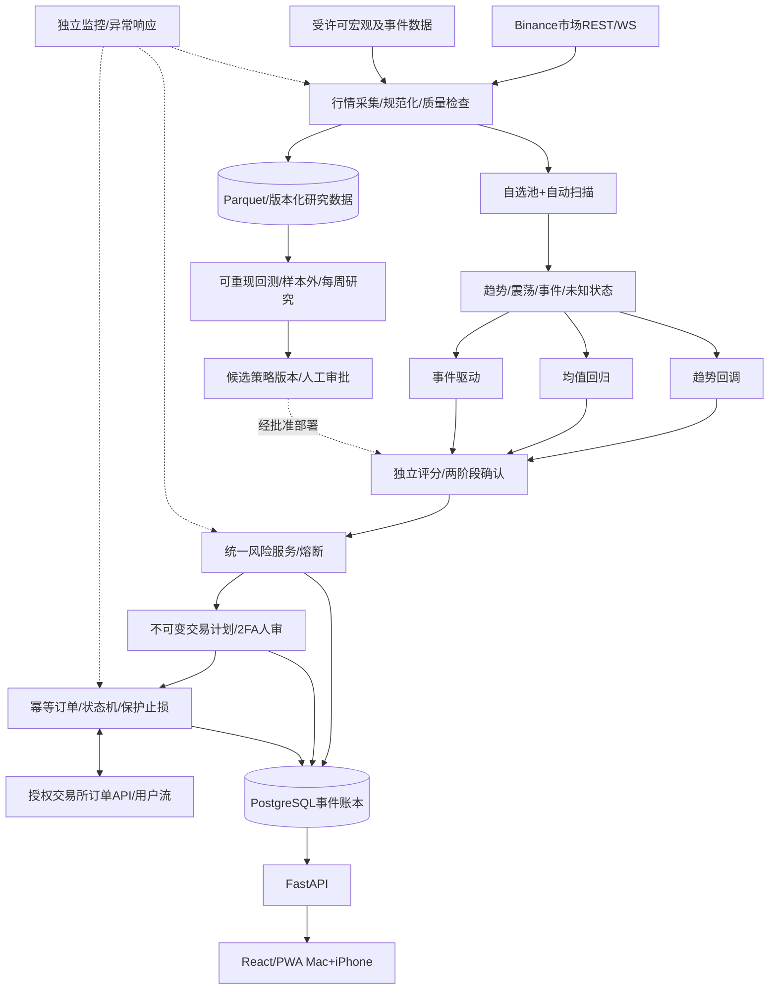

# 系统总体架构与可交付模块

## 总体数据流

## 工程选型
- Monorepo，模块化单体（一个API与多个独立Worker），Python 3.12+ / FastAPI / Pydantic / SQLAlchemy / Alembic。严格锁版本由Codex初始化。
- React + TypeScript + Vite SPA/PWA；响应式布局；仅使用经过许可的K线图表组件，先保证正确再做皮肤。
- PostgreSQL为订单、审批、风险、现金流、策略版本的**唯一事实来源**；Redis只缓存/消息通知，不能是订单唯一存储；Postgres transactional outbox。
- 历史1m/多周期K线存Parquet，研究在Mac本地用DuckDB/Parquet；外部事件按可用时刻（point-in-time）版本化。
- Docker Compose仅初期部署和测试；云端运行实时Worker，Mac承担高负载回测；生产加HTTPS、备份及恢复演练。

## 进程职责
| 服务 | 写入哪些数据 | 核心接口/约束 |
|---|---|---|
| market_worker | instrument_specs, raw hash, bars, quality events | 断线重连、closed-bar检查、历史回填 |
| signal_worker | regimes, signal_candidates, score_details, state | 策略隔离，不得直接下单 |
| risk_service | risk_snapshots, locks | 纯函数预检+DB锁，failure=>NO_NEW_RISK |
| execution_worker | orders, fills, position snapshots, reconcile events | 唯一被允许拥有交易权限的服务；初始接paper |
| research_worker | backtests, parameter candidates, artifacts | 每周优化只生成提案，不发实盘 |
| api | approvals, audit logs | 2FA, immutable snapshot, idempotency |
| monitor_worker | incidents, alert deliveries, service checks | 业务心跳+账户同步+交易就绪 |
| frontend | 无数据库直写 | 仅调用API/WS；不得接触交易所密钥 |

## 引擎边界与保证
- 市场消息至少一次到达 => 业务侧必须幂等，唯一键 `(venue, instrument, timeframe, open_time, source)` 或事件ID。
- `candidate != executable signal != approval != order`；这些均为独立持久化实体和状态。
- 任何订单异常、报价陈旧、账户对账失败、风控锁定时**拒绝新增风险**，保留安全的只减仓途径（需先确认交易所支持）。
- 真实交易必须有：权限核验 + 策略批准版本 + 有效行情 + 同步仓位 + 风控通过 + 确认交易计划 + 2FA + LIVE显式授权。阶段0—3任何一项为假。
- 一笔订单在手机、Mac同时点击审批时，依赖数据库原子更新+唯一约束+客户端幂等key，不能仅前端禁用按钮。

## 通用事件时间
`exchange_event_at`=交易所原始事件发生；`source_published_at`=外部数据源发布；`available_at`=策略真实可消费时间；`received_at`=本系统收到；`processed_at`=完成处理。数据库均存带时区UTC时间。信号回放只能读取当时`available_at<=decision_time`的数据。
